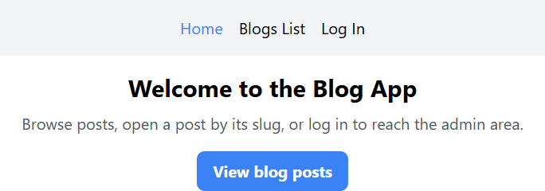
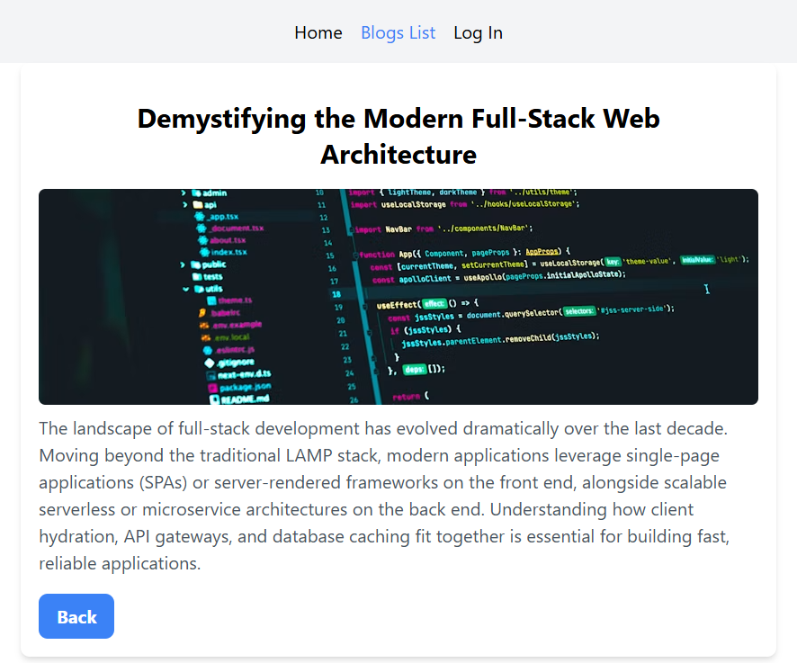
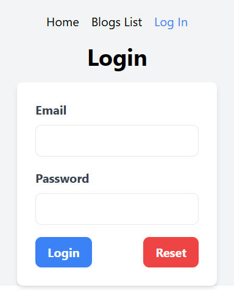
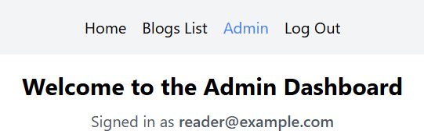
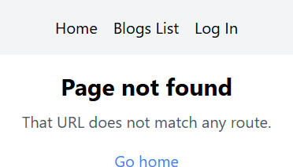

# Blog app

A small blog with client-side routes. The nav stays on every page.

## Description

Posts are a fixed list, and the admin page is only available after you log in.

| Path | Page |
| --- | --- |
| `/` | Home |
| `/blog` | The list of posts |
| `/blog/:slug` | That post, or “Post not found” if the slug is not in the list |
| `/login` | Login form |
| `/admin` | Admin dashboard |
| anything else | Page not found |

Opening `/admin` while signed out sends you to `/login`. After a successful login you return to the page you were trying to open, or to `/admin`.

The password is not checked. The email you type is saved as the signed-in name and shown on the admin page. Reset clears both fields. Log Out returns to Home.

The sign-in lasts only while the page stays open. A refresh signs you out.

Five posts. A narrow window shows one column, a medium window shows two, and a wide window shows five. Each card links to `/blog/` plus that post’s slug. The captured post address is `/blog/demystifying-the-modern-full-stack`. Blogs List stays highlighted because the address still starts with `/blog`. The captured admin page is signed in as `reader@example.com`.

## Screenshots

### Home

The current link is blue.



### Posts


### One post



### Login



### Admin



### Unknown URL



## Getting Started

### Dependencies

* Node.js and npm
* React 19, TypeScript, React Router, Vite, and Tailwind CSS

### Installing

```bash
npm install
```

### Executing program

```bash
npm run dev
```

Open the URL Vite prints, usually `http://localhost:5173/`.

| Command | What it does |
| --- | --- |
| `npm run build` | Type-check and build for production |
| `npm run preview` | Serve the production build |
| `npm run lint` | Run ESLint |

## Help

The password is not checked. A refresh signs you out. Opening `/admin` while signed out sends you to `/login`. A slug that is not in the list says “Post not found”. Any other unknown path says the page was not found.

## Authors

[Mamadou Moussa Balde](https://www.linkedin.com/in/2mb/)

## Version History

* Current local run
    * Vite, usually `http://localhost:5173/`
    * Home, the post list, one post, login, admin, and the not-found page were captured

## License

This folder does not include a `LICENSE.md` file.

## Acknowledgments

* [React](https://react.dev/)
* [React Router](https://reactrouter.com/)
* [Vite](https://vite.dev/)
* [Tailwind CSS](https://tailwindcss.com/)
* [README template](https://gist.github.com/DomPizzie/7a5ff55ffa9081f2de27c315f5018afc)
